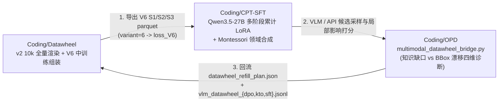

# AGENTS.md — Datawheel 编码代理工作约定

本文件为在 `Coding/Datawheel`（多模态视觉数据飞轮与工业级实物微调评测系统）内工作的 AI 编码代理提供开发规范、数据契约及跨项目互通说明（与 `Coding/CPT-SFT`、`Coding/OPD` 联动）。**在此目录执行任务前请先阅读本文件与上层 [`~/Documents/AGENTS.md`](../../AGENTS.md)。**

---

## 1. 系统定位与跨项目互通关系

`Datawheel`（GitHub: [qianlvguang/Datawheel](https://github.com/qianlvguang/Datawheel)）负责产出 **100% 绝对数学真理（零幻觉）** 的多模态合成图文与 QA 数据，并与 [`../CPT-SFT/`](../CPT-SFT/README.md)、[`../OPD/`](../OPD/README.md) 构成“生成 $\rightarrow$ 训练 $\rightarrow$ 诊断 $\rightarrow$ 定向补采”的完整数据飞轮：



| 联动项目 | 相对路径 | 互通接口与脚本 |
|---|---|---|
| **`Coding/CPT-SFT`** | `../CPT-SFT/` | 1. **V6 中训练接入**：本仓库 [`tools/build_v6_balanced_single.py`](tools/build_v6_balanced_single.py)、[`tools/build_v6_balanced_reference.py`](tools/build_v6_balanced_reference.py) 及 [`tools/assemble_v6_balanced.py`](tools/assemble_v6_balanced.py) 生成的 `S1/S2/S3` parquet 文件，严格对齐 `../CPT-SFT/training/qwen35_27b/` 的 `variant=6`（`loss_V6`）插件契约。<br>2. **偏好与 SFT 回流训练**：本仓库 [`tools/diagnose_and_refill_v6.py`](tools/diagnose_and_refill_v6.py) 产出的 `vlm_datawheel_{dpo,kto,sft}.jsonl` 可直接传入 `../CPT-SFT/training/swift/train_qwen35_27b_swift.sh` 或 `../CPT-SFT/training/domain_adaptation/montessori/train_teacher_dpo_swift.sh`。 |
| **`Coding/OPD`** | `../OPD/` | 1. **边查验、边造数诊断桥**：本仓库 [`tools/diagnose_and_refill_v6.py`](tools/diagnose_and_refill_v6.py) 直接调用 [`../OPD/multimodal_datawheel_bridge.py`](../OPD/multimodal_datawheel_bridge.py)，对 VLM/API 候选回答进行四维解耦诊断：<br>• `knowledge_gap_entity`（BBox IoU $\ge 0.50$ 但认错国旗/品牌 $\to$ 飞轮补采实体 + ToDi 前向 KL）<br>• `grounding_drift_bbox`（认对名字但 BBox IoU $< 0.50$ $\to$ 飞轮增加底板摆放难度 + VA-OPD 视觉优势加权）<br>• `visual_hallucination_negative`（Stage E 无图元/遮挡样本强行幻觉 $\to$ 自动配对导出 VLM DPO 负例）<br>• `spatial_or_count_error`（Stage C 计数/方位错误 $\to$ 学生 Rollout 反向 KL） |

---

## 2. 核心工程规范（不可违背）

1. **坐标系铁律**：
   - 所有归一化边界框统一采用以**左上角为原点 $(0, 0)$** 的相对坐标系，纵横范围均为 **$[0, 1000]$**，格式严格为 **`[ymin, xmin, ymax, xmax]`**（见 [`engine/coords.py`](engine/coords.py)）。
   - BBox 必须由透视/旋转形变后的**真实 Alpha 掩模**反算（`mask_to_rel_bbox_1000`），严禁使用未形变前的理论矩形框。
2. **Split 泛化隔离铁律**：
   - `train`、`val`、`test_unseen_entity`、`test_unseen_substrate`、`test_unseen_both` 由实体与底板 ID 的稳定哈希分桶决定。
   - **任何导出给 `CPT-SFT` 中训练（V6）或 `OPD` 蒸馏的数据构建器，只允许读取 `split == "train"` 的记录**，严禁将 `val` 或 `test_unseen_*` 混入训练集。
3. **文本语言卫生规范**：
   - 训练文本（caption / QA）只描述真实世界的商品品类、工艺位置、图案名称、颜色与可见特征；
   - **严禁出现**“程序化生成、矢量图、SVG、基准模式、Stage A”等内部实现术语（修改后须运行 [`tools/normalize_dataset_language.py`](tools/normalize_dataset_language.py) 清理）。
4. **路径与环境约定**：
   - 所有工具脚本放在 `tools/` 平级目录，通过 `PROJECT_ROOT = Path(__file__).resolve().parent.parent` 定位项目根目录，禁止硬编码本机绝对路径。
   - 运行环境使用项目自带 `.venv`（`.venv/bin/python tools/<script>.py`）。
   - 生成产物统一写入 `output/`（已被 `.gitignore` 忽略，切勿将大体积 parquet 或图片集加入 Git）。

---

## 3. 提交前必跑验证命令

在 `Coding/Datawheel` 根目录下执行：

```bash
# 1. Python 语法编译检查
.venv/bin/python -m py_compile generate.py pipeline.py engine/*.py tools/*.py

# 2. 官方实体中文命名 100% 覆盖校验
.venv/bin/python tools/verify_entity_names.py

# 3. 边查验边造数诊断桥冒烟测试（对接 Coding/OPD）
.venv/bin/python tools/diagnose_and_refill_v6.py --max-samples 6 --output-dir /tmp/dw_diag_check && rm -rf /tmp/dw_diag_check

# 4. 若修改了 v2 或 V6 数据生成产物，运行审计与契约门禁（要求 critical = 0）
# .venv/bin/python tools/flywheel_audit.py --dataset output/datawheel_v2/dataset.parquet --images-root . --out output/datawheel_v2/audit/
# .venv/bin/python tools/validate_swift_v6.py --input output/datawheel_v6_pilot/upload/datawheel_v6_pilot.parquet
```
